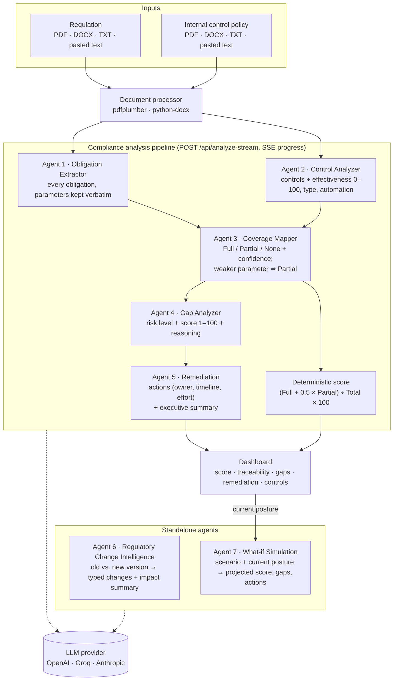

# regComply-AI

**Agentic banking regulatory intelligence platform.** Seven specialised AI agents turn a regulation and a bank's internal control policy into a traceable compliance chain: obligations → controls → coverage mapping → risk-ranked gaps → remediation plan → board summary. It also detects what changed between two versions of a regulation and simulates the impact of proposed rules.

Built for the **ET AI Hackathon: Agentic Edition** (presented by Accenture), **Problem Statement 1: Banking/Financial Regulations**.

| | |
|---|---|
| **Team** | Rahul Sain, Ansh Bhardwaj |
| **Pitch deck** | [deck/out/regComply-AI-pitch-deck.pdf](deck/out/regComply-AI-pitch-deck.pdf) |
| **Demo video** | [deck/out/regComply-AI-demo.mp4](deck/out/regComply-AI-demo.mp4) (screen recording of a real run, narrated) |
| **Claimed 9-blocker position** | **F3 / D2**: 11 of 14 features fully covered, structured-text input |

---

## Contents

1. [Quick start](#quick-start)
2. [Using the app](#using-the-app)
3. [Architecture](#architecture)
4. [Feature coverage vs. the problem statement](#feature-coverage-vs-the-problem-statement)
5. [API documentation](#api-documentation)
6. [Configuration](#configuration)
7. [Project structure](#project-structure)
8. [Reliability, responsible AI and known limitations](#reliability-responsible-ai-and-known-limitations)
9. [Rebuilding the deck and demo video](#rebuilding-the-deck-and-demo-video)
10. [Roadmap](#roadmap)

---

## Quick start

**Requirements:** Python 3.10 or newer (tested on 3.14), and an API key for one LLM provider: OpenAI, Groq (has a free tier) or Anthropic.

### Windows

```bat
git clone https://github.com/anshbhardwaj16/regComply-AI.git
cd regComply-AI
python -m venv .venv
.venv\Scripts\activate
pip install -r backend\requirements.txt
copy .env.example .env
rem edit .env: set LLM_PROVIDER and the matching API key
python -m uvicorn backend.main:app --host 127.0.0.1 --port 8000
```

`setup.bat` and `run.bat` do the install and launch steps for you.

### macOS / Linux

```bash
git clone https://github.com/anshbhardwaj16/regComply-AI.git
cd regComply-AI
python3 -m venv .venv
source .venv/bin/activate
pip install -r backend/requirements.txt
cp .env.example .env
# edit .env: set LLM_PROVIDER and the matching API key
python -m uvicorn backend.main:app --host 127.0.0.1 --port 8000
```

Then open **http://localhost:8000**. The backend serves the frontend, so there is no separate frontend build. Interactive API docs (Swagger) are at **http://localhost:8000/docs**.

Run the server from the repository root: the code imports `backend.*` as a package.

---

## Using the app

1. **Compliance Analysis** tab → click **Load Sample Data** (an RBI KYC master direction and a sample bank's KYC policy), or upload your own PDF / DOCX / TXT files or paste text.
2. Click **Run Agentic Analysis**. The pipeline view shows each agent finishing in real time (Server-Sent Events).
3. Review the results:
   - compliance score gauge, coverage counts and an executive summary
   - **Traceability**: click an obligation to see regulation → obligation → control → coverage and confidence → gap → remediation
   - **Gaps**: risk-ranked gap register (Critical / High / Medium / Low, score 1–100, reasoning)
   - **Remediation**: prioritised actions with owner, timeline and effort
   - **Controls**: AI effectiveness score (0–100), control type and automation level
   - **Obligations**: every extracted obligation with its coverage
4. Click **What-if Simulator**, pick or write a scenario (e.g. *"RBI reduces KYC refresh interval for high-risk customers from 2 years to 6 months"*) and run it to see the projected score, score change, new gaps and required actions.
5. **Export** downloads the full report as JSON.
6. **Regulatory Change Intelligence** tab → **Load Sample Data** (2022 vs. 2024 versions) → **Detect Regulatory Changes** to list new, amended, removed, stricter and relaxed requirements, each with impact level, required action and timeline, plus a CRO-style impact summary.

In the recorded demo, the full analysis of the built-in sample took about 31 seconds with `gpt-4.1`: 18 obligations, 8 controls, 9 gaps (2 Critical), weighted compliance score 61.1%.

---

## Architecture



### Agents

| # | Agent | Input | Output | Code |
|---|---|---|---|---|
| 1 | Obligation Extractor | regulation text (first 8,000 chars) | `id, regulation_ref, text, category, applicability` per obligation (up to 20) | [obligation_extractor.py](backend/agents/obligation_extractor.py) |
| 2 | Control Analyzer | control policy text (first 8,000 chars) | `id, policy_ref, text, category, owner, effectiveness_score, effectiveness_rating, control_type, automation_level` (up to 15) | [control_analyzer.py](backend/agents/control_analyzer.py) |
| 3 | Coverage Mapper | obligations + controls | `obligation_id, control_id, coverage (Full/Partial/None), confidence` | [mapper.py](backend/agents/mapper.py) |
| 4 | Gap Analyzer | obligations not fully covered | `id, obligation_id, obligation_text, regulation_ref, coverage, risk_level, risk_score, reasoning` | [gap_analyzer.py](backend/agents/gap_analyzer.py) |
| 5 | Remediation | gaps | `gap_id, priority, action, owner, timeline, effort` + 3–4 sentence executive summary | [remediation_agent.py](backend/agents/remediation_agent.py) |
| 6 | Regulatory Change | old + new regulation text (first 5,000 chars each) | typed changes, impact level, action, timeline + impact summary | [regulatory_change_agent.py](backend/agents/regulatory_change_agent.py) |
| 7 | What-if Simulation | scenario + current score, gaps, controls | projected score, delta, new/closed gaps, affected obligations, actions, narrative | [simulation_agent.py](backend/agents/simulation_agent.py) |

**Design choices**

- **No orchestration framework.** Each agent is one schema-constrained prompt; outputs are plain JSON passed to the next agent. That keeps every intermediate result inspectable and exportable.
- **Provider abstraction** in [llm_client.py](backend/services/llm_client.py): one `llm_call()` for OpenAI, Groq or Anthropic, chosen by `LLM_PROVIDER`.
- **JSON recovery** (`parse_json_response`): strips markdown fences and `<think>` blocks, and salvages every complete item from a truncated JSON array instead of failing the whole step.
- **Deterministic scoring**: the compliance score is computed in code from the mapper's output, not generated by the model.
- **Streaming**: `/api/analyze-stream` runs blocking LLM calls in a thread pool and emits an SSE event after each agent, so the UI shows real progress.

---

## Feature coverage vs. the problem statement

| # | Feature (Problem Statement 1) | Status | Where |
|---|---|---|---|
| 1 | Regulatory intelligence and knowledge ingestion | ✅ Full | document processor, Agent 1 |
| 2 | Regulatory change intelligence | ✅ Full | Agent 6 |
| 3 | Regulatory obligation extraction | ✅ Full | Agent 1 |
| 4 | Bank control-framework understanding | ✅ Full | Agent 2 |
| 5 | Regulatory-to-control mapping | ✅ Full | Agent 3 |
| 6 | Control effectiveness assessment | ✅ Full | Agent 2 (score, rating, type, automation) |
| 7 | Evidence-based compliance assessment | ⚠️ Partial | assessed from policy text; no separate evidence documents yet |
| 8 | Gap identification | ✅ Full | Agent 4 |
| 9 | Risk-based gap prioritization | ✅ Full | Agent 4 (risk score 1–100, sorted) |
| 10 | Remediation recommendation engine | ✅ Full | Agent 5 |
| 11 | Autonomous regulatory impact analysis | ✅ Full | Agent 6 impact summary |
| 12 | What-if / simulation capability | ✅ Full | Agent 7 |
| 13 | Cross-regulation intelligence | ⏳ Roadmap | |
| 14 | Regulatory contradiction detection | ⏳ Roadmap | |

**F3** requires at least 8 features; 11 are fully covered. **D2** (structured, textual input with demonstrable reliability) is supported by schema-constrained prompts, explicit parameter comparison in the mapper, JSON recovery, per-mapping confidence and a deterministic score. D3 would need multimodal input, which is on the roadmap.

---

## API documentation

All endpoints are served from the same origin as the UI. FastAPI also generates interactive docs at `/docs`.

### `GET /health`

```json
{ "status": "healthy", "provider": "openai", "version": "2.0.0" }
```

### `POST /api/analyze-stream` (used by the UI)

`multipart/form-data`. Provide each document as a file **or** as text.

| Field | Type | Notes |
|---|---|---|
| `regulation_file` / `regulation_text` | file / string | PDF, DOCX or TXT; or plain text |
| `control_file` / `control_text` | file / string | PDF, DOCX or TXT; or plain text |
| `regulation_name` | string | default `Banking Regulation` |
| `bank_name` | string | default `Sample Bank` |

Response: `text/event-stream`, one JSON object per `data:` line.

```text
data: {"event": "step", "step": "ingestion",   "status": "done", "msg": "Documents ingested"}
data: {"event": "step", "step": "obligations", "status": "done", "msg": "Extracted 18 obligations", "count": 18}
data: {"event": "step", "step": "controls",    "status": "done", "msg": "Analyzed 8 controls", "count": 8}
data: {"event": "step", "step": "mapping",     "status": "done", "msg": "Obligation-to-control mapping complete"}
data: {"event": "step", "step": "gaps",        "status": "done", "msg": "Identified 9 compliance gaps", "count": 9}
data: {"event": "step", "step": "remediation", "status": "done", "msg": "Generated 9 remediation actions"}
data: {"event": "complete", "result": { ...report... }}
```

On failure: `data: {"event": "error", "message": "..."}`.

### `POST /api/analyze` and `POST /api/analyze-text`

Same pipeline without streaming. `/api/analyze` takes the multipart form above; `/api/analyze-text` takes JSON:

```bash
curl -X POST http://localhost:8000/api/analyze-text \
  -H "Content-Type: application/json" \
  -d '{"regulation_text": "...", "control_text": "...", "regulation_name": "RBI KYC", "bank_name": "Sample Bank"}'
```

Both return the report. Excerpt from the recorded demo run (built-in sample, `gpt-4.1`):

```json
{
  "regulation_name": "RBI Master Direction on KYC 2024",
  "bank_name": "Sample Bank Ltd.",
  "total_obligations": 18, "fully_covered": 9, "partially_covered": 4, "not_covered": 5,
  "compliance_score": 61.1,
  "obligations": [{"id": "OBL-002", "regulation_ref": "1.2", "category": "KYC/AML", "applicability": "All banks",
                   "text": "Carry out fresh KYC of existing customers: High Risk every 2 years, Medium Risk every 8 years, Low Risk every 10 years."}],
  "controls": [{"id": "CTL-003", "policy_ref": "CTL-C", "category": "KYC/AML", "owner": "Compliance Team",
                "text": "KYC is reviewed periodically: High Risk every 3 years, Medium Risk every 8 years, Low Risk every 10 years; tracked in core banking system.",
                "effectiveness_score": 85, "effectiveness_rating": "Strong", "control_type": "Detective", "automation_level": "Semi-Automated"}],
  "mappings": [{"obligation_id": "OBL-002", "control_id": "CTL-003", "coverage": "Partial", "confidence": 0.7}],
  "gaps": [{"id": "GAP-001", "obligation_id": "OBL-005", "regulation_ref": "2.2", "coverage": "None",
            "obligation_text": "Apply Enhanced Due Diligence to PEPs, non-resident customers, and customers from high-risk countries.",
            "risk_level": "Critical", "risk_score": 95,
            "reasoning": "Failure exposes bank to money laundering, regulatory fines, and severe reputational damage."}],
  "remediations": [{"gap_id": "GAP-001", "priority": 1, "owner": "Compliance Officer", "timeline": "Immediate (0-30 days)", "effort": "High",
                    "action": "Implement EDD procedures and system controls for PEPs, non-residents, and high-risk country customers; train staff on new protocols."}],
  "executive_summary": "The compliance analysis identified 18 total obligations, with 9 fully covered, 4 partially covered, and 5 not covered, resulting in a weighted compliance score of 61.1%. ..."
}
```

Each run is generated by the model, so counts and wording can vary slightly between runs.

### `POST /api/change-analysis`

```json
{ "old_regulation_text": "...", "new_regulation_text": "...", "regulation_name": "RBI Master Direction on KYC" }
```

Returns:

```json
{
  "changes": [{
    "id": "CHG-010", "change_type": "New Requirement", "section_ref": "Section 4.1",
    "description": "Banks must implement zero-trust architecture for KYC systems by March 2025.",
    "impact_level": "Critical",
    "compliance_action": "Design and deploy zero-trust security for all KYC systems.",
    "implementation_timeline": "Long-term (6-12 months)",
    "affected_categories": ["Cybersecurity", "KYC/AML", "Operational"]
  }],
  "total_changes": 14, "critical_changes": 2, "high_impact_changes": 6,
  "impact_summary": "..."
}
```

`change_type` is one of `New Requirement`, `Amended Requirement`, `Removed Requirement`, `Stricter Enforcement`, `Relaxed Enforcement`; `impact_level` is `Critical`, `High`, `Medium` or `Low`.

### `POST /api/simulate`

Takes the current posture (the UI sends it from the last analysis) plus a scenario:

```json
{
  "scenario": "RBI reduces KYC refresh interval for high-risk customers from 2 years to 6 months",
  "bank_name": "Sample Bank Ltd.", "regulation_name": "RBI Master Direction on KYC 2024",
  "compliance_score": 61.1, "fully_covered": 9, "partially_covered": 4, "not_covered": 5,
  "gaps": [ ... ], "controls": [ ... ]
}
```

Returns (from the demo run):

```json
{
  "scenario_summary": "RBI shortens KYC refresh for high-risk customers from 2 years to 6 months.",
  "new_compliance_score": 54, "score_delta": -7,
  "newly_created_gaps": [{"id": "SIM-GAP-001", "risk_level": "High", "affected_control": "CTL-003",
                          "description": "KYC refresh for high-risk customers not performed every 6 months as now required."}],
  "closed_gaps": [],
  "affected_obligations": ["..."],
  "required_actions": [{"priority": "Immediate", "effort": "Medium",
                        "action": "Update KYC review policy to mandate 6-month refresh for high-risk customers."}],
  "simulation_narrative": "..."
}
```

---

## Configuration

Copy `.env.example` to `.env` (it is gitignored) and set:

| Variable | Required | Default | Description |
|---|---|---|---|
| `LLM_PROVIDER` | yes | `groq` | `openai`, `groq` or `anthropic` |
| `OPENAI_API_KEY` | if `openai` | | OpenAI key |
| `OPENAI_MODEL` | no | `gpt-4.1` | any chat model that accepts `temperature` (the demo used `gpt-4.1`) |
| `GROQ_API_KEY` | if `groq` | | Groq key (model `openai/gpt-oss-120b`) |
| `ANTHROPIC_API_KEY` | if `anthropic` | | Anthropic key (model `claude-haiku-4-5-20251001`) |

---

## Project structure

```text
regComply-AI/
├── backend/
│   ├── main.py                    FastAPI app: endpoints, SSE pipeline, scoring, serves frontend
│   ├── requirements.txt
│   ├── agents/                    the seven agents (one prompt + parser each)
│   ├── models/schemas.py          Pydantic models for the report entities
│   └── services/
│       ├── llm_client.py          provider abstraction + JSON recovery
│       ├── document_processor.py  PDF / DOCX / TXT → text
│       └── vector_store.py        ChromaDB scaffold for the roadmap (not used by the pipeline)
├── frontend/                      single-page app (vanilla HTML / CSS / JS, no build step)
├── deck/
│   ├── submission-deck.html       pitch deck source
│   ├── build.py                   builds the PDF, records the demo, assembles the video
│   └── out/                       regComply-AI-pitch-deck.pdf, regComply-AI-demo.mp4, narration.txt
├── .env.example
├── setup.bat / run.bat            Windows install / launch helpers
└── README.md
```

---

## Reliability, responsible AI and known limitations

**What the system does to stay reliable**

- Every agent is prompted for an exact JSON schema at temperature 0.1 (OpenAI and Groq).
- Extraction agents keep frequencies, deadlines, thresholds and scope verbatim, and the mapper must mark a control **Partial** when it is weaker than the obligation on any parameter. Example from the sample: the regulation requires high-risk KYC refresh every 2 years, the policy does it every 3 years, so this is reported as partial coverage, not a match.
- Agents are told that gaps are valuable findings and to prefer reporting a gap over force-fitting a match, to avoid false assurance.
- Every mapping carries a confidence score, and the traceability view shows the full chain behind each finding.
- The compliance score is calculated in code, not by the model.
- Truncated model output is salvaged item by item rather than failing the run.

**Human oversight.** regComply-AI produces a first-pass analysis for compliance officers to review; it does not make compliance decisions.

**Privacy.** Documents are processed in memory and nothing is stored server-side, but document text is sent to the configured LLM provider. Use a provider and account approved for the data you upload.

**Known limitations**

- Only the first 8,000 characters of each document are analysed (5,000 for change analysis). Long regulations need chunked retrieval, which is on the roadmap.
- Text only: images and scanned pages inside PDFs are not OCR'd.
- Model output can vary between runs; scores and gap counts may differ slightly for the same input.
- No persistence: each analysis is independent and is not saved.
- Feature 7 (evidence) is assessed from policy text only; features 13 and 14 are not implemented yet.

---

## Rebuilding the deck and demo video

[`deck/build.py`](deck/build.py) regenerates the submission assets. It needs the backend dependencies plus `playwright`, `imageio-ffmpeg` and `pypdf`, and Google Chrome installed.

```bat
pip install playwright imageio-ffmpeg pypdf
python -m playwright install ffmpeg
python deck\build.py slides   :: deck PDF + slide images
python deck\build.py demo     :: starts the app and records a real end-to-end run (needs an LLM key in .env)
python deck\build.py video    :: narrates and assembles deck/out/regComply-AI-demo.mp4
```

Narration uses OpenAI `gpt-4o-mini-tts` when `OPENAI_API_KEY` is set; set `NARRATOR=windows` to use the offline Windows voice instead. Waiting time in the recording is fast-forwarded and labelled "sped up" on screen.

---

## Roadmap

- **Next:** chunked retrieval for long documents, multimodal input (image/table OCR), evidence document ingestion (F7), cross-regulation intelligence (F13), contradiction detection (F14).
- **Then:** continuous monitoring of regulatory feeds, multi-bank / multi-jurisdiction tenancy, compliance posture history, audit trail, regulator-facing report export.
- **Later:** tuning on bank-specific policy corpora, core-banking integrations, RBI / SEBI / BIS feed connectors, self-hosted LLM option for on-premises deployments.
